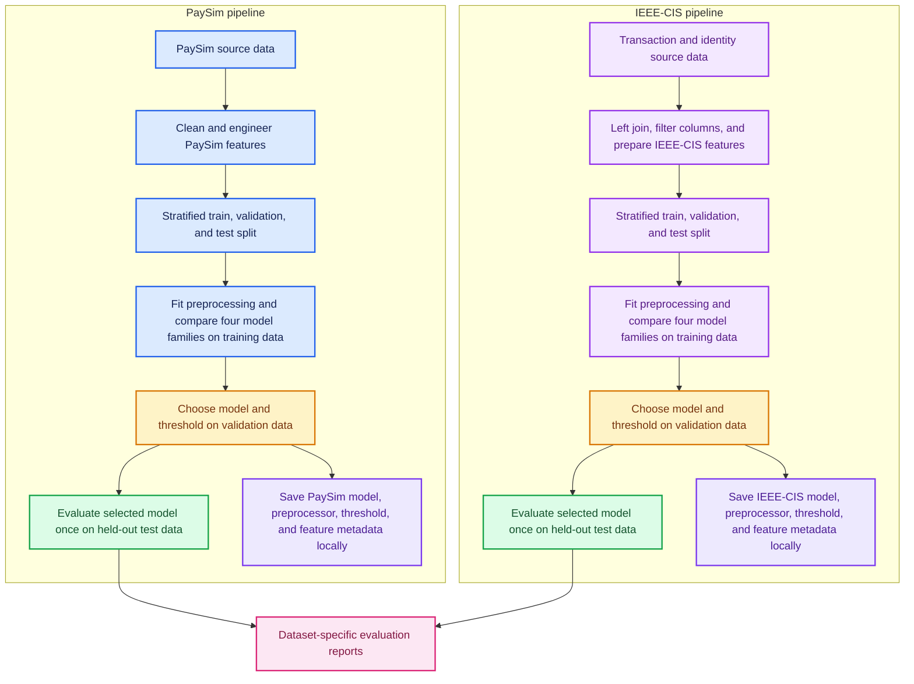
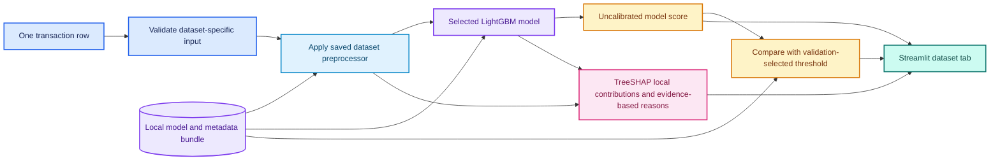

# FedGuard — System Architecture

This document describes the implemented FedGuard Micro Project and separates it from planned future stages.

## 1. Scope and trust boundary

The Micro Project is a centralized, local research prototype that trains and scores separate PaySim and IEEE-CIS models. The datasets are public benchmark data used to represent two institution types; the app does not connect to banks, payment networks, or customer accounts. Raw datasets and fitted model artifacts remain local and are excluded from Git.

The longer-term project explores cross-institution fraud detection. Federated learning, differential privacy, secure aggregation, and deployment-grade controls are not implemented in this Micro Project.

## 2. End-to-end flow

Dataset preparation and evaluation use separate pipelines for each dataset. Preprocessing and resampling are fit or applied only to training data; validation is used for model and threshold selection, and the held-out test split is evaluated once afterward.

Runtime scoring and explanation path:

The saved bundles, data, and preprocessing artifacts are local and excluded from Git. PaySim and IEEE-CIS have distinct bundles and reports. The application does not send transaction data to a federated service.

**Diagram key:** blue = PaySim or transaction input · purple = IEEE-CIS or saved model artifacts · amber = validation-selected decision · green = held-out test evaluation · teal = Streamlit view · pink = explanation or report.

PaySim and IEEE-CIS retain separate features, preprocessing artifacts, models, thresholds, and reports.

## 3. Dataset preparation

### PaySim

PaySim contains 6,362,620 synthetic mobile-money transactions. The pipeline treats isFraud as the target, excludes account identifiers and the isFlaggedFraud rule flag, handles transaction type as categorical, and derives balance-difference, zero-balance, time, and log-amount features. Post-transaction balance fields make the use retrospective.

### IEEE-CIS

IEEE-CIS has 590,540 labeled transaction rows and 144,233 identity rows. The pipeline left-joins identity data to transactions by TransactionID, adds a has_identity indicator, and excludes TransactionID from predictors. It calculates the greater-than-90%-missingness feature filter on training rows only, then fits imputers and encoders on the training partition. Many feature names are coded or anonymized; explanations retain their supplied names.

Both datasets use stratified train/validation/test splits with 70/15/15 proportions and seed 42. Preprocessors and resampling are fit/applied on training data only. Validation and test retain natural prevalence.

## 4. Imbalance handling and model comparison

The model families are Logistic Regression, Random Forest, XGBoost, and LightGBM. The comparison uses validation metrics; it does not evaluate every comparison model on test.

- PaySim compares class weights, capped SMOTE, and capped SMOTE-ENN (117 candidate fits).
- IEEE-CIS compares class weights and capped SMOTE (78 candidate fits).
- The separate IEEE-CIS capped SMOTE-ENN experiment has 39 candidates and is validation-only; it did not improve Average Precision over class weights for any family.

The selected model for both datasets is LightGBM with class weights. Resampling is restricted to training data.

## 5. Threshold and evaluation protocol

The operating threshold is selected on validation data to maximize recall subject to a false-positive rate no greater than 1%. It is then applied unchanged to the selected model’s held-out test split, which is evaluated once.

Report Average Precision (AP), ROC-AUC, precision, recall, F1, and FPR. The stored metric key pr_auc represents Average Precision in the reports. Keep validation family comparisons separate from final test results. Do not adjust a threshold or select a model based on test metrics.

## 6. Inference and explanation path

The common inference module loads the dataset-specific selected model, fitted preprocessor, metadata, and feature metadata from local artifacts. It validates the input schema, transforms one row with the saved preprocessor, calculates the model output, and compares it to the saved validation threshold.

The TreeSHAP module explains one selected-model prediction. It ranks the strongest feature contributions, maps transformed features to supplied source names where possible, records the direction and input value, and checks that contributions add to the model raw output within tolerance. Plain-language reasons describe observed feature contributions; they do not establish causation or prove fraud.

SHAP contribution values use the model’s raw-output scale, not probability points. IEEE-CIS anonymized attributes remain labeled as supplied. No probability-calibration study is documented, so outputs must be described as uncalibrated model scores.

## 7. Streamlit interface

The app has separate PaySim and IEEE-CIS tabs. It loads a limited set of reference examples from the validation partition. PaySim allows editing transaction type, amount, and balance fields; derived balance features are recalculated before inference. IEEE-CIS allows editing selected transaction/card fields while retaining other fields from the selected reference row.

The app displays the model score, threshold decision, local explanation when available, and a centralized summary of selected-model test metrics. The current shell renders SHAP contributions as signed text bars. A reusable Matplotlib explanation component exists separately; it should not be described as the active dashboard chart unless the shell is changed to call it.

## 8. Selected model results

### Validation-selected operating points

| Dataset | Selected model / strategy | Threshold | Validation AP |
| --- | --- | ---: | ---: |
|  | LightGBM / class weights | 0.0568012 | **0.999986** |
|  | LightGBM / class weights | 0.7675237 | **0.758107** |

### Held-out test performance

| Dataset | Average Precision | ROC-AUC | Precision | Recall | F1 | FPR |
| --- | ---: | ---: | ---: | ---: | ---: | ---: |
|  | **0.997968** | **0.998691** | 0.973080 | 0.997565 | 0.985170 | 0.003567% |
|  | **0.756757** | **0.959075** | 0.710193 | 0.687964 | 0.698902 | 1.017758% |

**Dataset color key:** PaySim is blue; IEEE-CIS is purple. Validation thresholds and final held-out test metrics are shown separately to make the evaluation boundary explicit.

The validation FPR ceiling is 1%. IEEE-CIS test FPR is 1.017758%; report it as observed rather than tuning against the test result. Full validation family comparisons and confusion counts are in the reports and project handover.

## 9. Limitations and planned research

- PaySim is synthetic; its near-perfect metrics do not demonstrate real-world performance.
- PaySim balance-after-transaction fields mean the example is retrospective, not pre-transaction prevention.
- IEEE-CIS has extensive missingness and anonymized attributes, limiting semantic interpretation.
- Scores are not calibrated real-world fraud probabilities.
- The local centralized demo is not a production service and does not make customer decisions.
- Federated learning, differential privacy, secure aggregation, external institution integration, and public hosting remain future work.
