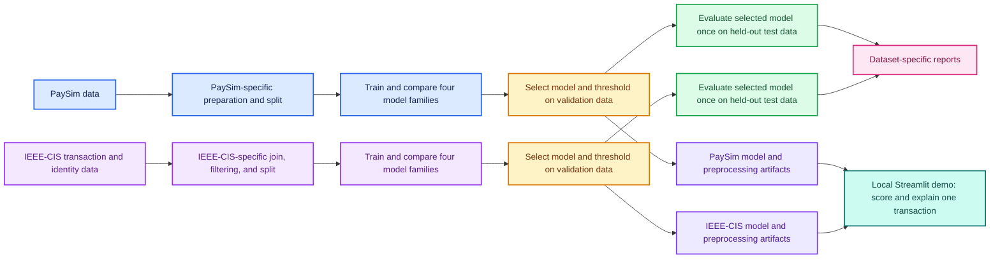

# FedGuard

## Privacy-Preserving Multi-Institutional Financial Fraud Detection Using Federated Learning and Explainable AI

FedGuard is an academic project exploring fraud-risk modeling and explainability across two simulated financial-institution settings. The completed **Micro Project** trains and evaluates separate centralized models for PaySim mobile-money transactions and IEEE-CIS card/e-commerce transactions, then demonstrates single-transaction scoring and local SHAP explanations in Streamlit.

The current Micro Project is a **centralized research demonstration**. It does not train a federated model, connect to real financial institutions, block transactions, or make customer decisions. Federated learning and privacy mechanisms are future stages.

## Current Micro Project

The end-to-end workflow is:

1. Audit and prepare each dataset independently.
2. Make a stratified train/validation/test split and fit preprocessing on training rows only.
3. Compare Logistic Regression, Random Forest, XGBoost, and LightGBM with documented imbalance strategies.
4. Select the model and decision threshold using validation data.
5. Evaluate each selected model once on its untouched held-out test split.
6. Use saved local artifacts for inference, thresholding, and single-transaction SHAP explanations.
7. Review the results and demo through a local Streamlit application.

The threshold rule for both datasets is to maximize recall subject to a validation false-positive rate (FPR) no greater than 1%. Validation comparisons are distinct from final test results.

**Flowchart key:** blue = PaySim · purple = IEEE-CIS · amber = validation selection · green = held-out test · teal = dashboard · pink = reports.

PaySim and IEEE-CIS stay separate throughout preparation, model selection, scoring, and reporting. The final test split is held out from model and threshold selection.

## Datasets

| Dataset | Simulated institution | Characteristics |
| --- | --- | --- |
|  | Mobile money | Synthetic transactions with transaction types, amounts, and account-balance fields. |
|  | Card/e-commerce | Labeled transaction data joined with identity data; many fields are coded or anonymized. |

The datasets have separate feature pipelines, saved models, thresholds, and reports. IEEE-CIS feature names such as C*, D*, V*, and id_* are retained as supplied; the project does not assign undocumented business meanings to them.

## Selected model results

The selected model for both datasets is LightGBM with class weights. The saved reports use the key pr_auc; the project presents this measure as **Average Precision (AP)**. FPR below is expressed as a percentage.

### Validation-selected operating points

| Dataset | Selected model | Threshold | Validation AP |
| --- | --- | ---: | ---: |
|  | LightGBM · class weights | 0.0568012 | **0.999986** |
|  | LightGBM · class weights | 0.7675237 | **0.758107** |

### Held-out test performance

| Dataset | Average Precision | ROC-AUC | Precision | Recall | F1 | FPR |
| --- | ---: | ---: | ---: | ---: | ---: | ---: |
|  | **0.997968** | **0.998691** | 0.973080 | 0.997565 | 0.985170 | 0.003567% |
|  | **0.756757** | **0.959075** | 0.710193 | 0.687964 | 0.698902 | 1.017758% |

**Dataset color key:** PaySim is blue; IEEE-CIS is purple. The threshold is selected using validation data; the test metrics are reported separately and are not used to tune it.

The IEEE-CIS test FPR is slightly above the 1% validation target. The threshold was selected without test data and must not be tuned using the test result. Only the selected LightGBM model for each dataset has final test metrics; the four-family model comparison is validation-only.

Full metrics, threshold-selected validation comparisons, audit summaries, and precision-recall figures are available in the reports directory:
- PaySim: reports/paysim_metrics.json and reports/figures/paysim_pr_curves.png
- IEEE-CIS: reports/ieee_cis_metrics.json and reports/figures/ieee_cis_pr_curves.png
- IEEE-CIS validation-only SMOTE-ENN experiment: reports/ieee_cis_smote_enn_validation.json

## Inference, SHAP, and dashboard

The shared inference interface loads the selected dataset-specific model, preprocessor, threshold, and feature metadata from local artifacts. It validates a one-transaction input, applies the saved preprocessing, calculates a model score, and compares it with the saved validation-selected threshold.

The SHAP explanation layer reports the strongest local feature contributions, their directions, supplied source-feature names, and evidence-based reasons. SHAP values describe how features affected this model's output for one transaction; they do not prove fraud or establish causation. Anonymized IEEE-CIS fields remain identified by their supplied names.

The Streamlit demo has a dataset selector and three main views: **Transaction score + SHAP**, **Model results**, and **Scope and limitations**. The transaction view supports a one-row CSV template/upload or a validation reference example. PaySim examples allow editing transaction type, amount, and balances; related engineered balance features are recalculated before scoring. IEEE-CIS examples allow editing selected card/e-commerce fields while the remaining inputs stay from the chosen validation example. Both dataset flows show the uncalibrated score, validation-selected threshold, threshold decision, heuristic interface category, and local SHAP explanation when available. A model selector allows scoring with the XGBoost comparison model or the selected LightGBM model. Model results keep the four-family validation comparison separate from the selected LightGBM held-out test metrics.

The demo is for review and education. Scores are **not calibrated real-world fraud probabilities**, and the interface is not a production transaction-scoring service.

## Run locally

A fresh Git clone does not contain the large model, preprocessor, feature-metadata, or processed-data artifacts. Obtain the separately shared Stage 1 transfer bundle and copy its models and data/processed subfolders into the matching locations under the repository root. Keep these generated artifacts out of Git.

From PowerShell at the repository root:

    python -m venv .venv
    .\.venv\Scripts\Activate.ps1
    python -m pip install -r requirements.txt
    python -m streamlit run app\streamlit_app.py

The dashboard requires the selected model artifacts and the processed validation examples. By default, it looks in the repository root. To keep the transfer bundle outside the clone, set `FEDGUARD_ARTIFACT_ROOT` to its extracted folder before launching, or enter that folder in the dashboard sidebar. See docs/micro_demo_runbook.md for setup and demonstration guidance.

## Repository map

    app/                 Streamlit application and explanation view
    data/                Raw/processed local data; excluded from Git
    docs/                Data cards, decisions, handoff, and demo runbook
    models/              Trained models and preprocessors; excluded from Git
    reports/             Metrics, audits, EDA summaries, and figures
    scripts/             Audit, preparation, training, and validation scripts
    src/common/          Shared preprocessing, inference, evaluation, and SHAP code
    tests/               Unit and integration-contract tests
    .github/workflows/   Automated test workflow

## Scope, limitations, and future work

- **PaySim is synthetic.** Its very high scores do not establish performance on real payment activity. Its post-transaction balance fields make the demo retrospective, not pre-transaction fraud prevention.
- **IEEE-CIS features are partly anonymized.** Explanations can show model contributions but cannot supply business meaning absent from the source documentation.
- **The displayed outputs are model scores.** No calibration study is documented; do not call them calibrated fraud probabilities.
- **The current Micro Project is centralized.** It does not implement federated learning, differential privacy, or secure aggregation.
- **The dashboard is a local research demonstration.** It does not block transactions or make customer decisions. The repository does not establish a public hosted deployment.

Future stages may explore federated learning across simulated institutions, differential privacy, and secure aggregation. Those are planned research directions, not completed Micro Project results.

## Project roadmap

| Stage | Status | Focus |
| --- | --- | --- |
| **Micro** | Complete | Centralized dataset preparation, four-family model comparisons, selected-model evaluation, inference, SHAP, and local Streamlit demonstration. |
| **Mini** | Planned | Federated learning experiments across simulated institutions. |
| **Minor** | Planned | Differential privacy experiments and privacy-budget analysis. |
| **Major** | Planned | Secure aggregation research and broader system hardening. |

## Documentation and experiment tracking

- System and design decisions: ARCHITECTURE.md and docs/decisions.md
- Stage 1 training protocol and handoff: docs/stage1_plan.md and docs/HANDOVER.md
- Local demonstration instructions: docs/micro_demo_runbook.md
- Dataset descriptions: docs/data_card_paysim.md and docs/data_card_ieee_cis.md
- Final threshold audit: docs/final_threshold_validation.md
- W&B experiment project: https://forge.coreweave.com/wandb/ndugar007-bharati-vidyapeeths-college-of-engineering/fedguard-stage1

## Team

- Naman Dugar — data audit, preparation, training, model comparisons, threshold validation, and result documentation.
- Anvi Tyagi — shared model inference interface, Streamlit integration, and demo hardening.
- Riyanshu — SHAP explanation core, evidence-based reasons, and explanation-view component.

## Academic details

- **College:** Bharati Vidyapeeth's College of Engineering, New Delhi
- **Department:** Department of Computer Science and Engineering
- **Mentor:** Prof. Mohit Tiwari, Assistant Professor
- **Project title:** Privacy-Preserving Multi-Institutional Financial Fraud Detection Using Federated Learning and Explainable AI
